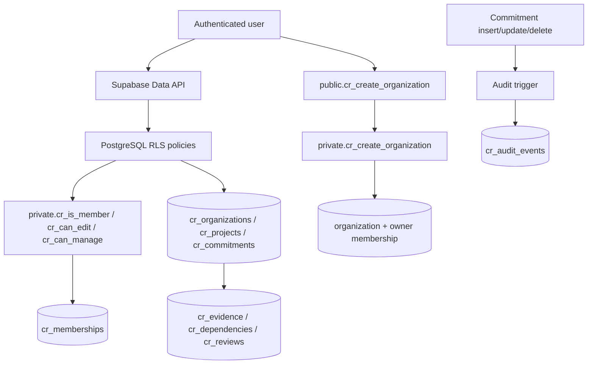

# Commitment Radar — Backend Architecture (Phase 2)

## Verified current state

- Supabase project: `htfrixfcirgrhlmwtkjs`, explicitly retained for Commitment Radar by the owner.
- The project is still in the Supabase organization named **Hashttick**; the connected tools do not expose organization rename/transfer controls.
- Eight application tables use the isolated `cr_*` prefix and have RLS enabled.
- Authorization is tenant-scoped through organization membership and roles.
- The application data tables are currently empty; no customer data was modified during hardening.
- The applied migration is recorded in Supabase as `20261015120014_commitment_radar_backend_hardening`.
- Its source is stored under `commitment-radar/supabase/migrations/20261015120014_commitment_radar_backend_hardening.sql`.

## Request and authorization path

The diagram describes the intended and inspected database flow; it is not a runtime trace.

## Security decisions

- RLS remains enabled on all eight `public.cr_*` tables.
- Membership/role predicates now live in the non-API `private` schema with a fixed `search_path`.
- The exposed organization-creation RPC is a `SECURITY INVOKER` wrapper. The private implementation validates `auth.uid()`, bounds the name to 2–120 characters, then creates the organization and owner membership in one transaction.
- Anonymous execution is revoked from the public RPC. Authenticated execution remains enabled.
- Policies reference private authorization helpers; public helper RPC endpoints are removed.
- Fourteen indexes now cover foreign keys identified by Supabase's performance advisor.
- Composite foreign keys already enforce organization consistency for project/commitment/evidence/dependency/review relationships.
- No service-role key is required by this schema layer.

## Failure and recovery

- Apply the versioned migration only once per environment. Do not reapply it manually to a database where it is recorded.
- Keep the original project and unrelated Hashttick root files unchanged.
- A reconstructed baseline migration is now stored at `supabase/migrations/20261015112619_commitment_radar_initial_schema.sql`, using the live pre-hardening catalog as evidence. It was not applied to the current project. Because the original historical file was unavailable, this is a reconstruction rather than a byte-for-byte recovery; clean-room bootstrap still needs validation in a separate disposable Supabase environment.

## Verification

The companion `supabase/tests/security_contract.sql` checks table existence, RLS enablement, helper placement, RPC grants, wrapper security mode, and all fourteen supporting indexes. Supabase security advisor returned no findings after the migration. Performance advisor returned no unindexed foreign keys; it still reports unused-index INFO findings because the Commitment Radar tables have not yet received workload.
